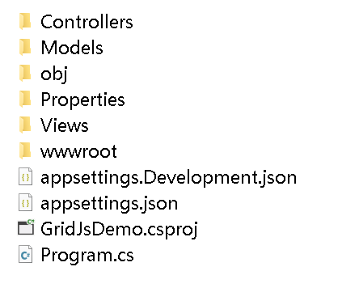
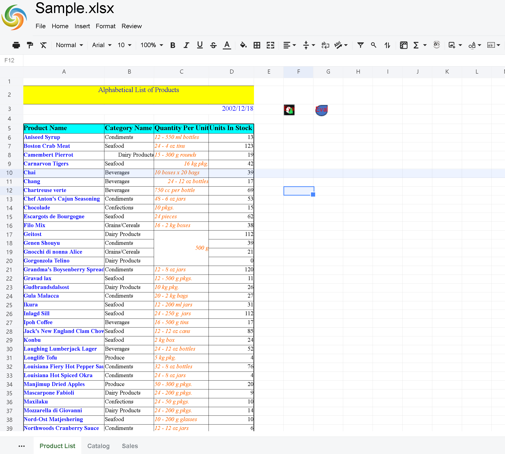

# Load a Spreadsheet with GridJs

## Introduction

This article demonstrates how to **load an Excel workbook into a web page** using the **Aspose.Cells.GridJs** library on the server side and the **gridjs‑spreadsheet** JavaScript library on the client side.  
You will create a **.NET 6 MVC** application, configure the Aspose.Cells.GridJs service, implement a controller that returns the workbook JSON, and write the client‑side HTML/JavaScript that renders the spreadsheet and enables server‑side updates.

## Run all framework examples

The project includes four npm-based client examples that share this ASP.NET Core backend:

| Client | Development URL | npm import |
|---|---|---|
| React | `http://127.0.0.1:5183` | `gridjs-spreadsheet/react` |
| Vue 3 | `http://127.0.0.1:5174` | `gridjs-spreadsheet/vue` |
| Angular | `http://127.0.0.1:4200` | `gridjs-spreadsheet/angular` |
| JavaScript | `http://127.0.0.1:5175` | `gridjs-spreadsheet` |

Requirements:

- .NET 6 SDK or newer
- Node.js 26 (recommended), Node.js 24.15.0+, or Node.js 22.22.3+
- npm

From `Examples_GridJs.Simple`, run one command:

```bash
npm start
```

The first run installs all workspace dependencies, then starts the .NET backend and all four frontend development servers. Open `http://127.0.0.1:5079` to choose an example. Press `Ctrl+C` once to stop all processes.

After dependencies are installed, use `npm run dev` for faster startup. To run only one client with the backend:

```bash
npm run dev:react
npm run dev:vue
npm run dev:angular
npm run dev:npm
```

To build the four clients into `wwwroot/demos` and serve them from ASP.NET Core:

```bash
npm run build
npm run serve
```

The framework adapters in `gridjs-spreadsheet` 26.7.1 use `/GridJs2` by default, so this project includes a compatibility controller for those actions. The original Razor example continues to use `/GridJs`.

## Run with Docker

Docker builds all four npm clients and publishes the ASP.NET Core application into one runtime image. Node.js and the .NET SDK are used only in the build stages and are not included in the final runtime image.

### What you need

For the Docker workflow, the host machine only needs:

- Docker Desktop, or Docker Engine
- Docker Compose v2 (`docker compose`)
- An internet connection during the first build to download base images, npm packages, and NuGet packages

You do **not** need to install Node.js, npm, the .NET SDK, or Microsoft Excel on the host machine.

Verify Docker before starting:

```bash
docker --version
docker compose version
```

### Start everything with one command

Open a terminal in the project directory:

```bash
cd Examples_GridJs.Simple
docker compose up --build
```

This command performs the complete workflow:

1. Installs the npm workspace dependencies with `npm ci`.
2. Builds the React, Vue, Angular, and JavaScript npm examples.
3. Restores and publishes the ASP.NET Core application.
4. Creates the final Linux runtime image.
5. Creates the GridJs cache volume.
6. Starts the application on port `8080`.

The first build can take several minutes because Docker must download the base images and dependencies. Later builds reuse Docker's cache.

Keep this terminal open while the application is running. Press `Ctrl+C` to stop the foreground process.

### Open the examples

After the container starts, open the launcher:

<http://localhost:8080>

All clients and server APIs are served by the same container and origin:

| Page | URL |
|---|---|
| Framework launcher | <http://localhost:8080/> |
| Razor + CDN example | <http://localhost:8080/GridJs/Index> |
| React example | <http://localhost:8080/demos/react/> |
| Vue example | <http://localhost:8080/demos/vue/> |
| Angular example | <http://localhost:8080/demos/angular/> |
| JavaScript npm example | <http://localhost:8080/demos/npm/> |
| Container health check | <http://localhost:8080/health> |

Each spreadsheet example opens the same `wwwroot/files/Sample.xlsx` workbook. A successful load shows the `Product List`, `Catalog`, and `Sales` worksheets.

### Run in the background

The recommended command for normal use is:

```bash
docker compose up --build --detach
```

Check whether the container is running and healthy:

```bash
docker compose ps
```

The status should contain `Up` and `healthy`. You can also check the health endpoint:

```bash
curl http://localhost:8080/health
```

Follow the application logs:

```bash
docker compose logs --follow gridjs-simple
```

Press `Ctrl+C` to stop following the logs; this does not stop the container.

### Stop, start, or restart

Stop the container without removing it:

```bash
docker compose stop
```

Start the existing stopped container:

```bash
docker compose start
```

Restart the application:

```bash
docker compose restart gridjs-simple
```

Stop and remove the container and its Compose network:

```bash
docker compose down
```

`docker compose down` does not delete the GridJs cache volume.

### Rebuild after changing the source

After changing the .NET code, framework examples, npm dependencies, or workbook files, rebuild and recreate the container:

```bash
docker compose up --build --detach
```

If Docker is using stale build output, perform a clean image build:

```bash
docker compose build --no-cache
docker compose up --detach
```

### Use another port

Port `8080` is the default. On macOS or Linux, set `GRIDJS_PORT` before starting:

```bash
GRIDJS_PORT=8090 docker compose up --build --detach
```

Then open <http://localhost:8090>.

In Windows PowerShell:

```powershell
$env:GRIDJS_PORT = "8090"
docker compose up --build --detach
```

### GridJs cache persistence

The named volume `gridjs-cache` is mounted at `/app/App_Data/GridJsCache` inside the container. GridJs uses this directory for workbook, image, and update-operation cache files.

The volume survives:

- Container restarts
- `docker compose stop`
- `docker compose down`
- Image rebuilds

To intentionally remove the container **and all GridJs cache data**, run:

```bash
docker compose down --volumes
```

Do not use `--volumes` if the cached workbook state must be preserved.

### Docker architecture

The image uses three build stages:

1. `node:24-alpine` builds the four npm clients into `wwwroot/demos`.
2. `mcr.microsoft.com/dotnet/sdk:6.0-jammy` publishes the ASP.NET Core project.
3. `mcr.microsoft.com/dotnet/aspnet:6.0-jammy` runs the published application as the non-root `gridjs` user.

The runtime image contains the Linux SkiaSharp native assets, `fontconfig`, and common fonts required for spreadsheet rendering. Only port `8080` is exposed.

### Troubleshooting

#### Port 8080 is already in use

Start the container on another host port:

```bash
GRIDJS_PORT=8090 docker compose up --build --detach
```

#### The container is not healthy

Inspect its status and recent logs:

```bash
docker compose ps
docker compose logs --tail=200 gridjs-simple
```

The application must be able to write to `/app/App_Data/GridJsCache`, and <http://localhost:8080/health> must return `Healthy`.

#### A framework page returns 404

Make sure the URL ends with `/`, for example:

```text
http://localhost:8080/demos/react/
```

Then rebuild the image so the latest `wwwroot/demos` output is included:

```bash
docker compose up --build --detach
```

#### The first build cannot download an image or package

The first build requires access to Docker Hub, Microsoft Container Registry, npm, and NuGet. Check the Docker Desktop proxy or network settings, then retry:

```bash
docker compose up --build --detach
```

Docker resumes from cached layers when possible.

#### Reset the demo completely

The following command deletes the container and the GridJs cache volume:

```bash
docker compose down --volumes
```

Start again with:

```bash
docker compose up --build --detach
```

> {}
> The manual, non-Docker setup described below assumes that **.NET 6 SDK** and **Node.js** are installed on the host machine. The Docker workflow above does not require either tool on the host.
> {}

## Prerequisites

| Item | Version | How to obtain |
|------|---------|----------------|
| .NET SDK | 6.0 or later | <https://dotnet.microsoft.com/download> |
| Aspose.Cells | 26.\* (NuGet) | `dotnet add package Aspose.Cells --version 26.*` |
| Aspose.Cells.GridJs | 26.\* (NuGet) | `dotnet add package Aspose.Cells.GridJs --version 26.*` |
| Newtonsoft.Json | 13.0.1 (NuGet) | `dotnet add package Newtonsoft.Json --version 13.0.1` |
| jQuery, jQuery‑UI, JSZip | specific versions listed in the requirement | CDN links are used in the HTML sample |

## Create a .NET 6 MVC Project

Open a terminal and run:

```bash
dotnet new mvc -n GridJsDemo
cd GridJsDemo
```

The generated folder structure looks like this:



> {}
> Ensure the project targets **net6.0** (the default for the template).  
> You can verify this in the `<TargetFramework>` element of **GridJsDemo.csproj**.
> {}

## Server‑Side Setup

### 1. Add Required Packages

```bash
dotnet add package Aspose.Cells --version 26.*
dotnet add package Aspose.Cells.GridJs --version 26.*
dotnet add package Newtonsoft.Json --version 13.0.1
```

### 2. Register GridJs Services

Edit **Program.cs** (or **Startup.cs** if you prefer the classic style) and add the following code inside the `builder.Services` section:

```csharp
// Program.cs
using Aspose.Cells.GridJs;

var builder = WebApplication.CreateBuilder(args);
var gridJsCacheDirectory = Path.Combine(builder.Environment.ContentRootPath, "App_Data", "GridJsCache");
var httpsRedirectionEnabled = builder.Configuration.GetValue("HttpsRedirection:Enabled", true);
Directory.CreateDirectory(gridJsCacheDirectory);

// Add MVC services
builder.Services.AddControllersWithViews();
builder.Services.AddHealthChecks();

// ---------------------------------------------------------------------
// GridJs service registration
// ---------------------------------------------------------------------
builder.Services.AddScoped<IGridJsService, GridJsService>();

builder.Services.Configure<GridJsOptions>(options =>
{
    // Portable cache path for Windows, macOS, and Linux.
    options.FileCacheDirectory = gridJsCacheDirectory;

    // • Base route name for all GridJs actions (e.g. /GridJs/LoadSpreadsheet)
    options.BaseRouteName = "/GridJs";
});

var app = builder.Build();

// ---------------------------------------------------------------------
// Middleware pipeline
// ---------------------------------------------------------------------
if (!app.Environment.IsDevelopment())
{
    app.UseExceptionHandler("/Home/Error");
    if (httpsRedirectionEnabled)
    {
        app.UseHsts();
        app.UseHttpsRedirection();
    }
}
app.UseDefaultFiles();
app.UseStaticFiles();

app.UseRouting();

app.UseAuthorization();

// Map default MVC route
app.MapControllerRoute(
    name: "default",
    pattern: "{controller=Home}/{action=Index}/{id?}");

app.MapHealthChecks("/health");
app.Run();
```

> {}
> The example creates `App_Data/GridJsCache` automatically. The application process must have write permission to that directory.
> {}

### 3. Implement the GridJs Controller

Create a new folder **Controllers** (if not present) and add **GridJsController.cs**:

```csharp
// Controllers/GridJsController.cs
using System.Text;
using Aspose.Cells.GridJs;
using Aspose.Cells.GridJs.Controllers;
using Microsoft.AspNetCore.Mvc;

namespace GridJsDemo.Controllers
{
    // Route prefix matches the BaseRouteName configured earlier.
    [Route("GridJs/[action]")]
    public class GridJsController : GridJsControllerBase
    {
        private readonly IGridJsService _gridJsService;

        public GridJsController(IGridJsService gridJsService) : base(gridJsService)
        {
            _gridJsService = gridJsService;
        }

        // -------------------------------------------------------------
        // Returns the default view that hosts the client‑side UI.
        // -------------------------------------------------------------
        public IActionResult Index()
        {
            return View("Index");
        }

        // -------------------------------------------------------------
        // Loads a workbook, converts it to JSON and returns it.
        // -------------------------------------------------------------
        [HttpGet]
        public ActionResult LoadSpreadsheet(string filename, string uid)
        {
            // Resolve the physical path of the file (e.g. from wwwroot/files)
            string fullFilePath = GetFullFilePath(filename);

            // Generate JSON that includes workbook data, active sheet, etc.
            StringBuilder json = _gridJsService.DetailFileJsonWithUid(fullFilePath, uid);

            // Return plain text (JSON) with UTF‑8 encoding.
            return Content(json.ToString(), "text/plain", Encoding.UTF8);
        }

        // -------------------------------------------------------------
        // Helper: builds the absolute file path.
        // -------------------------------------------------------------
        private string GetFullFilePath(string filename)
        {
            // Example: files are stored under wwwroot/files
            string basePath = Path.Combine(Directory.GetCurrentDirectory(), "wwwroot", "files");
            return Path.Combine(basePath, filename);
        }
    }
}
```

> {}
> The `GridJsControllerBase` already implements actions for cell updates, image handling, OLE download, etc. You only need to add the **LoadSpreadsheet** action (and optionally **Index** if you want a custom view).  
> All URLs used by the client are automatically resolved relative to the `BaseRouteName`.
> {}

### 4. Add a Sample Workbook

Create the folder **wwwroot/files** and place an Excel file, for example **Sample.xlsx**. The file will be used by the demo.

### 5. Create the MVC View

Add a new folder **Views/GridJs** and create **Index.cshtml**:

```html
@{
    Layout = null;   // Simple page without the default layout
}
<!DOCTYPE html>
<html lang="en">
<head>
    <meta charset="utf-8" />
    <title>GridJs Spreadsheet Demo</title>

    <!-- jQuery & jQuery UI -->
    <script src="https://code.jquery.com/jquery-2.1.1.min.js"></script>
    <script src="https://code.jquery.com/ui/1.12.1/jquery-ui.min.js"></script>
    <link rel="stylesheet" href="https://code.jquery.com/ui/1.12.1/themes/base/jquery-ui.css" />

    <!-- JSZip (required by gridjs‑spreadsheet for export) -->
    <script src="https://cdnjs.cloudflare.com/ajax/libs/jszip/3.6.0/jszip.min.js"></script>

    <!-- GridJs Spreadsheet UI -->
    <link rel="stylesheet" href="https://unpkg.com/gridjs-spreadsheet/xspreadsheet.css" />
    <script src="https://unpkg.com/gridjs-spreadsheet/xspreadsheet.js"></script>

    <!-- Custom demo script -->
    <script src="~/js/gridjs-demo.js"></script>

    <style>
        /* Full‑screen container */
        #gridjs-demo-uid {
            width: 100%;
            height: 95vh;
        }
    </style>
</head>
<body>
    <!-- GridJs UI placeholder -->
    <div id="gridjs-demo-uid"></div>
</body>
</html>
```

> {}
> The view uses **Layout = null** to keep the page minimal. If you prefer to use the default layout, remove the line and place the `<div id="gridjs-demo-uid"></div>` inside a section.
> {}

### 6. Client‑Side JavaScript (gridjs‑demo.js)

Create the folder **wwwroot/js** and add **gridjs-demo.js**:

```javascript
/* wwwroot/js/gridjs-demo.js
   --------------------------------------------------------------
   Step‑by‑step script that:
   1. Generates a UUID for the session.
   2. Requests workbook JSON from the server.
   3. Loads the JSON into GridJs Spreadsheet.
   4. Configures server‑side update mode and image handling URLs.
   -------------------------------------------------------------- */

// Utility: generate a RFC4122 version‑4 UUID
function generateUUID() {
    // Simplified but sufficient for demo purposes
    return 'xxxxxxxx-xxxx-4xxx-yxxx-xxxxxxxxxxxx'.replace(/[xy]/g, function (c) {
        const r = Math.random() * 16 | 0,
              v = c === 'x' ? r : (r & 0x3 | 0x8);
        return v.toString(16);
    });
}

// ----------------------------------------------------------------
// Configuration constants – match the routes defined in GridJsController
// ----------------------------------------------------------------
const queryJsonUrl   = "/GridJs/LoadSpreadsheet";
const updateUrl      = "/GridJs/UpdateCell";
const fileDownloadUrl = "/GridJs/Download";
const oleDownloadUrl  = "/GridJs/Ole";
const imageUrl        = "/GridJs/ImageUrl";
const imageUploadUrl1 = "/GridJs/AddImage";
const imageUploadUrl2 = "/GridJs/AddImageByURL";
const imageCopyUrl    = "/GridJs/CopyImage";

// Global GridJs instance
let xs = null;

// ----------------------------------------------------------------
// Main entry point – called when the page finishes loading
// ----------------------------------------------------------------
$(function () {
    const uid = generateUUID();               // Unique session identifier
    const filename = "Sample.xlsx";           // Change if you use a different file

    // Build the request URL with query string parameters
    const requestUrl = `${queryJsonUrl}?filename=${encodeURIComponent(filename)}&uid=${uid}`;

    // ----------------------------------------------------------------
    // 1️⃣ AJAX request: obtain workbook JSON from the server
    // ----------------------------------------------------------------
    $.ajax({
        url: requestUrl,
        method: "GET",
        dataType: "text",          // Server returns plain text (JSON string)
        success: function (responseJsonString) {
            const jsonData = JSON.parse(responseJsonString);
            loadWithOption(jsonData);
        },
        error: function (xhr, status, err) {
            console.error("Failed to load workbook JSON:", err);
        }
    });
});

/**
 * Loads the JSON data into the GridJs UI and applies the required options.
 * @param {Object} jsondata – The deserialized JSON object returned by the server.
 */
function loadWithOption(jsondata) {
    // ----------------------------------------------------------------
    // 2️⃣ Define GridJs load options
    // ----------------------------------------------------------------
    const option = {
        // Server‑side update mode – each cell edit will be POSTed to UpdateCell
        updateMode: 'server',
        updateUrl: updateUrl,
        // UI language (change as needed)
        local: 'en'
    };

    // Clean any previous instance
    $('#gridjs-demo-uid').empty();

    // Extract worksheet array and filename from the server payload
    const sheets = jsondata.data;
    const filename = jsondata.filename;

    // ----------------------------------------------------------------
    // 3️⃣ Initialise GridJs and bind it to the placeholder div
    // ----------------------------------------------------------------
    xs = x_spreadsheet('#gridjs-demo-uid', option)
        .loadData(sheets)
        .updateCellError(function (msg) {
            console.error("Cell update error:", msg);
        });

    // Optional UI tweaks
    if (!jsondata.showtabs) {
        xs.bottombar.hide();               // Hide sheet tabs if not required
    }

    // Store unique identifier and original filename (used by the server)
    xs.setUniqueId(jsondata.uniqueid);
    xs.setFileName(filename);

    // ----------------------------------------------------------------
    // 4️⃣ Set the active sheet and cell (fallback to first sheet if needed)
    // ----------------------------------------------------------------
    let activeSheetName = jsondata.actname;
    if (xs.bottombar.dataNames.indexOf(activeSheetName) >= 0) {
        xs.setActiveSheetByName(activeSheetName)
          .setActiveCell(jsondata.actrow, jsondata.actcol);
    } else {
        // Fallback – first visible worksheet
        activeSheetName = xs.bottombar.dataNames[0];
        xs.setActiveSheetByName(activeSheetName).setActiveCell(0, 0);
    }

    // ----------------------------------------------------------------
    // 5️⃣ Register image‑related and download URLs
    // ----------------------------------------------------------------
    xs.setImageInfo(imageUrl, imageUploadUrl1, imageUploadUrl2, imageCopyUrl, 1000,"/image/loading.gif");
    xs.setFileDownloadInfo(fileDownloadUrl);
    xs.setOleDownloadInfo(oleDownloadUrl);
    xs.setOpenFileUrl("/GridJs/Index"); // URL to reopen the demo page
}
```

> {}
> The script uses **jQuery** for the AJAX call and DOM ready handling. All URLs correspond to the actions provided by `GridJsControllerBase`; you do not need to implement them yourself.
> {}

## Running the Demo

1. **Restore NuGet packages**  

   ```bash
   dotnet restore
   ```

2. **Build and run**  

   ```bash
   dotnet run
   ```

3. Open a browser and navigate to **https://localhost:5001/GridJs/Index** (or the URL displayed in the console).  
   You should see the spreadsheet UI loaded with the content of **Sample.xlsx**.



## Common Issues & Tips

{}
- **Cache directory unavailable** – Ensure the application can create and write to `App_Data/GridJsCache`.
- **CORS errors** – When hosting the client and server on different origins, enable CORS in `Program.cs`.  
- **Large files** – GridJs converts the workbook to JSON in memory; for very large files consider increasing the server memory limit or using pagination features of the library.  
{}


## Demo and Source Code

The complete source code for this tutorial is available in the official Aspose.Cells.GridJs GitHub repository:

<https://github.com/aspose-cells/Aspose.Cells.Grid-for-.NET/tree/main/Examples_GridJs.Simple>

## Additional Resources

* **GridJs Server API** – <https://reference.aspose.com/cells/net/aspose.cells.gridjs>  
* **GridJs Client API** – <https://docs.aspose.com/cells/net/aspose-cells-gridjs/how-to-use-gridjs-client-api/>
* **GridJs‑spreadsheet NPM package** – <https://www.npmjs.com/package/gridjs-spreadsheet>
 


---
